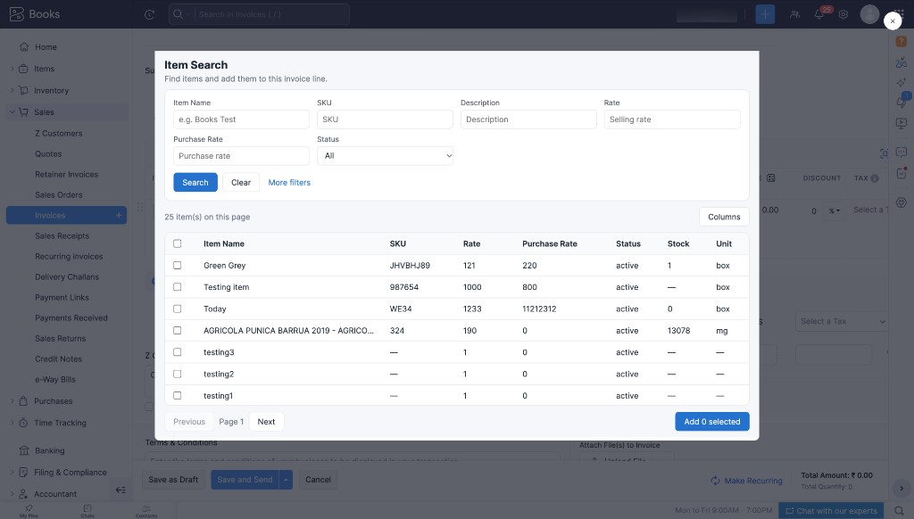

# Item Search

A **Zoho Books invoice widget** that lets you **search items with filters**, customize the results table, and **add selected items** to the current invoice line.

This project is set up for **Zoho Books** (`plugin-manifest.json` → `"service": "FINANCE"` / Books org install). To use the same widget in another Zoho Finance app (for example Invoice, Inventory, or Expense), change the `service` value in `plugin-manifest.json` to the service that app expects, then pack and upload again for that app.

## What this widget shows

After you fill filters and click **Search**, the widget loads matching items and shows them in a selectable table. You can then add the selected rows to the invoice.

| Area | What you see |
| --- | --- |
| **Filters** | Item Name, SKU, Description, Rate, Purchase Rate, Status, plus More filters (EAN, UPC, MPN, ISBN, Serial Numbers) |
| **Results table** | Matching items with columns you choose (name, SKU, rate, purchase rate, status, stock, unit, and more) |
| **Actions** | Select rows, page through results, and **Add selected** items to the invoice |

You can also:

- **Customize columns** — open **Columns**, tick the fields you want, then click **Done** to save the preference
- **Paginate** — 25 items per page with Previous / Next
- **Clear** — reset filters and results

Column preference is stored per user via the Books user metadata API (`/users/{user_id}/metadata/itempref`), so the same columns come back the next time you open the widget.

The widget appears only on the **invoice line-item add** action (location: `invoice.lineitem.add`, `widget_type: modal`). Opening `widget.html` in a normal browser tab will not load live data.

### Screenshots

**Item Search modal**



## How to pack, upload, and view the widget

### 1. Prerequisites

- Node.js and npm
- [Zoho Extension Toolkit (ZET)](https://www.zoho.com/books/developer/) installed
- Access to a Zoho Books organization

### 2. Install dependencies and build

```bash
cd /path/to/ItemsSearch
npm install
npm run build
```

Always run `npm run build` after you change anything under `src/`.

### 3. Create the connection (required before the widget can load data)

Create a connection for this widget with:

| Setting | Value |
| --- | --- |
| Connection link name | `get_items` (must match `plugin-manifest.json` exactly) |
| Service | Zoho Books |
| Scope | `ZohoBooks.items.READ`, `ZohoBooks.users.READ`, `ZohoBooks.users.UPDATE` |
| User access | Yes |

- **Items read** is required for search.
- **Users read / update** are required to load and save column preference in user metadata.

Without this connection and scopes, **Search** or saving columns will fail.

### 4. Pack the widget with ZET

From the project root:

```bash
zet pack
```

This creates a zip under the `dist/` folder (for example `dist/ItemsSearch.zip`).

### 5. Upload in Zoho Books and open on an invoice

1. Open your **Zoho Books** organization.
2. Upload / install the widget zip from `dist/` in that organization (Settings → Developer Space / Widgets, or the widgets upload path used in your org).
3. Authorize the **`get_items`** connection when prompted.
4. Open **Sales → Invoices → New Invoice** (or edit an invoice).
5. Use the line-item add action that opens **Item Search**.
6. Enter filters, click **Search**, select items, then click **Add selected**.

You should then see matching items in the table, and selected rows appended to the invoice line items.

## Local testing with ZET

`npm start` alone is not enough for a working widget in Books. You need Zoho Books **developer / development mode** and ZET serving the project.

1. Rebuild after code changes:

```bash
npm run build
```

2. From the project root, start ZET:

```bash
zet run
```

3. In Zoho Books, turn on **development mode** for the widget / extension so the invoice modal loads from your local ZET server (`https://127.0.0.1:<port>`).
4. Open the browser URL ZET prints and allow the self-signed certificate if prompted.
5. Open an invoice in Zoho Books and open **Item Search**. Live data still needs the **`get_items`** connection authorized.

## APIs used

```text
GET  {api_root_endpoint}/items
GET  {api_root_endpoint}/users/{user_id}/metadata/itempref
PUT  {api_root_endpoint}/users/{user_id}/metadata/itempref
```

Called through `ZFAPPS.request` with the `get_items` connection and `organization_id`.

Selected items are added with:

```text
ZFAPPS.set('invoice.line_items', lineItems)
```

Each new line uses `item_id`, `name`, `description`, `rate` (string), and `quantity: '1'`. Books **appends** these lines; do not send existing line items again.

The API host comes from `ZFAPPS.get('organization').organization.api_root_endpoint` (for example `https://zohoapis.localzoho.com/books/v3` or `https://www.zohoapis.com/books/v3`).

## Project structure

| Path | Purpose |
| --- | --- |
| `src/` | React source — edit here |
| `src/main.jsx` | `window.onload`, `ZFAPPS.extension.init()`, resize, org/user load |
| `src/App.jsx` | Search, pagination, column prefs, add selected |
| `src/SearchForm.jsx` | Top filters and More filters |
| `src/ResultsTable.jsx` | Item results table and row selection |
| `src/ColumnPicker.jsx` | Column checkboxes and Done |
| `src/api.js` | Items search, column pref GET/PUT, add line items |
| `src/columns.js` | Default column list |
| `src/styles.css` | Widget styles |
| `app/` | Built files Zoho loads (`widget.html` + assets) |
| `plugin-manifest.json` | Modal location, service, and connection name |
| `widget.html` | Vite entry HTML (build input) |
| `vite.config.js` | Builds React into the `app` folder |
| `docs/images/` | README screenshots |
| `dist/` | Zip from `zet pack` (not committed) |

## Tech stack

- React
- Vite (build)
- Zoho Finance Widget SDK (`ZFAPPS`)

## Notes

- Results are **25 items per page**, sorted by `created_time` descending.
- Column preference is saved when you click **Done** in the Columns picker.
- Opening the widget outside Books (plain browser tab) will not initialize `ZFAPPS` with live org data.
- Always rebuild with `npm run build` before packing or testing in Books; Books loads `/app/widget.html`, not the `src/` files.
